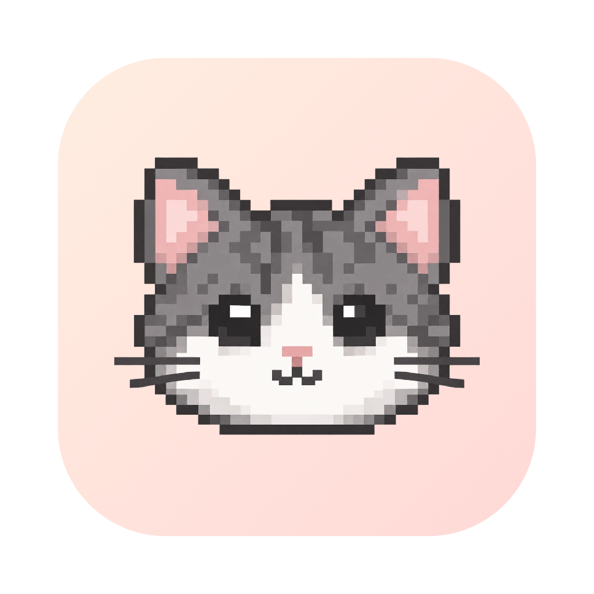
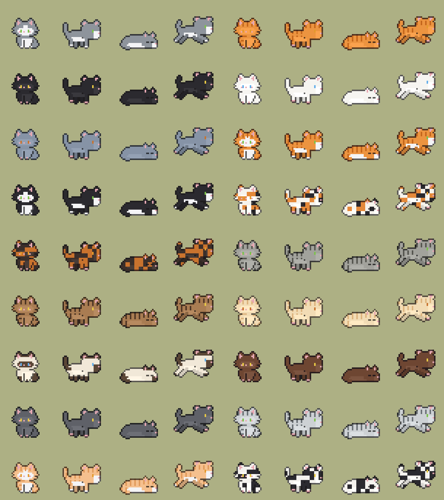
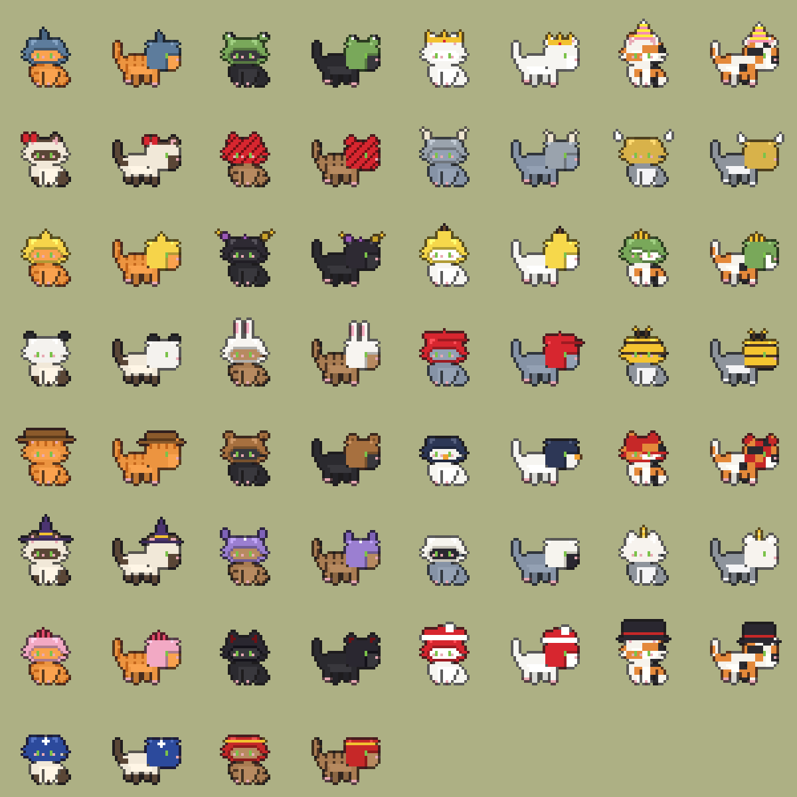
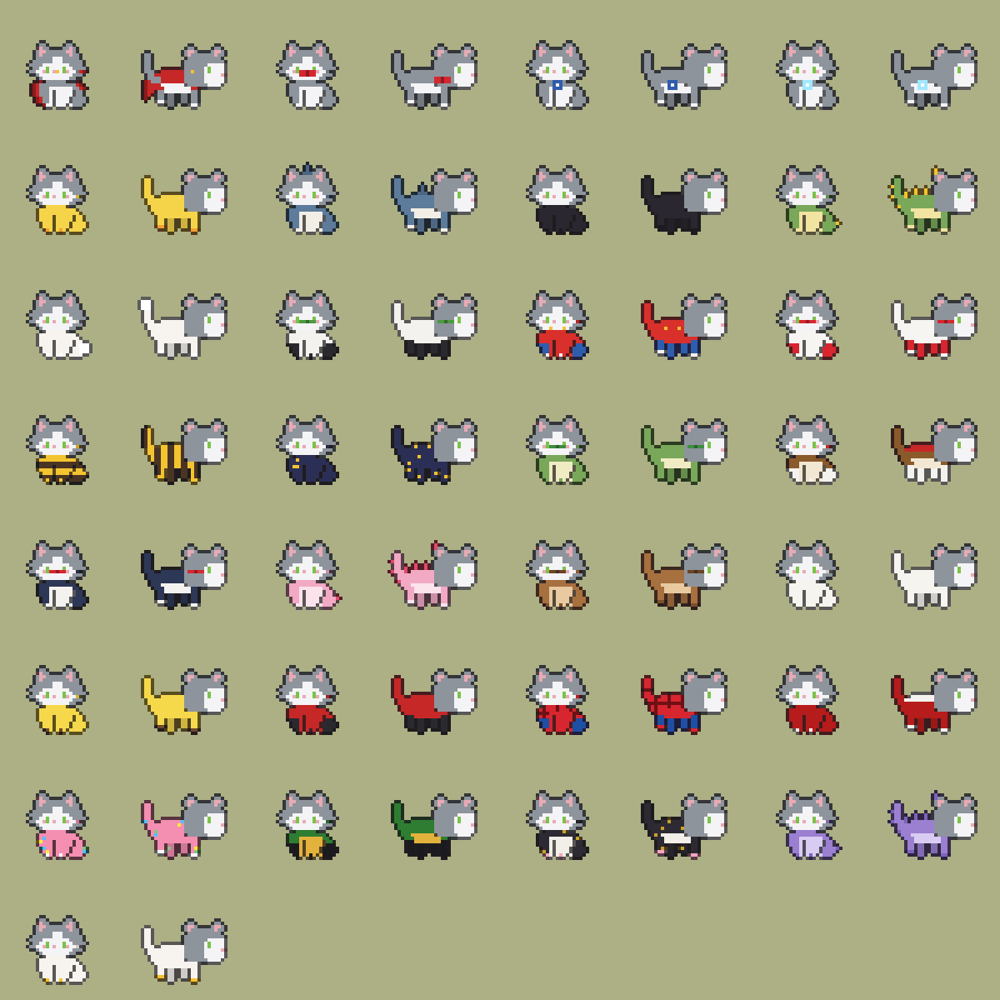

# Kotiki

Desktop cats for your screen. They roam the bottom of the display, climb onto your windows, sharpen their claws on the screen edge and chase your cursor. Close the window a cat is dozing on and it tumbles to the floor with an offended face.

Clicks pass straight through the cats, so you keep working as usual. You can feed them, pet them with the cursor and dress them up as a shark or a banana.

The cats are pixel art: small sprites with crisp edges that sit, walk, gallop, climb window sides, sleep and hiss.

📣 **Follow the news here:** [t.me/kotiki_mestosa](https://t.me/kotiki_mestosa)

## Pick your version

| Platform | Folder | Status | Download |
|---|---|---|---|
| **macOS** 13+ (Apple Silicon and Intel) | [`macos/`](macos) | Stable, version 2.3 | [Latest release](https://github.com/Lamesna/desk-cats/releases/latest), file `Kotiki-2.3-macOS.zip` |
| **Windows** 10 / 11 (64-bit) | [`windows/`](windows) | Beta, version 0.3.3 | [Windows release](https://github.com/Lamesna/desk-cats/releases/tag/windows-v0.3.3), file `Kotiki-0.3.3-Windows-x64.zip` |

The macOS app is native Swift. The Windows app is a separate port built with Electron. Both draw the same pixel cats and share the same costumes and behavior, but the code is independent.

### macOS

1. Download `Kotiki-2.3-macOS.zip` from the latest release, unzip it and drag `Kotiki.app` into Applications.
2. On first launch macOS says it cannot verify the developer, because the app has no Apple certificate. Open System Settings, Privacy & Security, scroll down and click "Open Anyway". On macOS 14 and older, right-click the app and choose Open.
3. The cat icon in the menu bar opens your cat list, bowls, laser pointer and outfits. Hold Option and drag to pick up a cat.

Details and build instructions: [`macos/README.md`](macos/README.md).

### Windows (beta)

1. Download `Kotiki-0.3.3-Windows-x64.zip` from the Windows release and unzip it anywhere.
2. Double-click `Kotiki.exe`. If Windows shows "Windows protected your PC", click "More info", then "Run anyway" (the app is not signed).
3. The cat icon sits in the notification area at the right of the taskbar (click the ^ arrow if it is hidden). Hold Ctrl and drag to pick up a cat.

This is a first release and it has not been tested on many machines. Cats walk on open windows and the taskbar, but not on desktop icons or widgets. Details and build instructions: [`windows/README.md`](windows/README.md).

## Languages

The app speaks English, Russian and Chinese (简体中文). It starts in your system language and you can switch it any time with the globe menu at the bottom of the Kotiki menu. The menu, coat and outfit names, cat moods and default cat names all follow the chosen language.

## What the cats do

- Walk along the floor, jump onto windows and climb up their sides. Up top they sleep, loaf, wash and sharpen their claws.
- Travel between windows like climbing stairs: walk to the nearest edge, hop to the next window, and keep going until they reach the one they wanted.
- Get down in different ways: some jump, some slide down the side of the window, claws digging in.
- Hang from the bottom edge of a window or widget, paw over paw.
- Only use edges you can see: a cat never crawls along a window edge that another window covers.
- When a window slides over a cat, it sometimes falls and sometimes grabs the window in front, clings to its side and climbs up.
- Climb the side edges of the screen and scratch them like a scratching post.
- Fall when you close the window under them, then hiss and sulk.
- Stalk a sleeping cat, or one with its back turned, wiggle their rumps and pounce. A tumble follows.
- Sniff each other, box, wrestle in a ball of fur, play tag and sleep cheek to cheek.
- Purr when you hold the cursor over them.

## Care and play

- Put food and water bowls anywhere on the screen. A hungry cat finds its bowl on its own.
- Every cat has food, water, energy and mood bars.
- The laser pointer turns your cursor into a red dot. Cats leap after it, and the three most agile ones hang on the cursor and swing as you move the mouse.
- Hold ⌥ Option (macOS) or Ctrl (Windows) and drag to pick up a cat or a bowl. A thrown cat flies in an arc.

## Looks

- 18 coats: gray and white, ginger, black, calico, Siamese and more.
- 6 eye colors, including odd eyes.
- 30 hats and 29 costumes: shark, banana, dinosaurs, panda, bunny, bee, witch, Santa and more. Nearly every hat has a matching costume.

Superhero-style items are "inspired by" designs: no logos, letters or character names.

## Repository layout

| Folder | What is inside |
|---|---|
| `macos/` | The macOS app (Swift, AppKit, SwiftUI) and `build.sh` |
| `windows/` | The Windows app (Electron, JavaScript) and its packaging script |
| `docs/` | Pictures for this README |

## License

MIT, see the `LICENSE` file.
