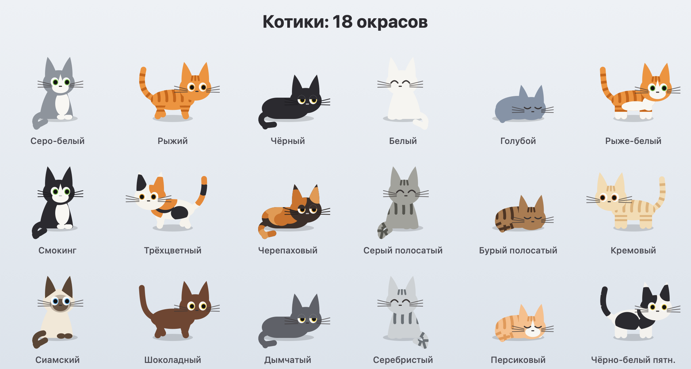
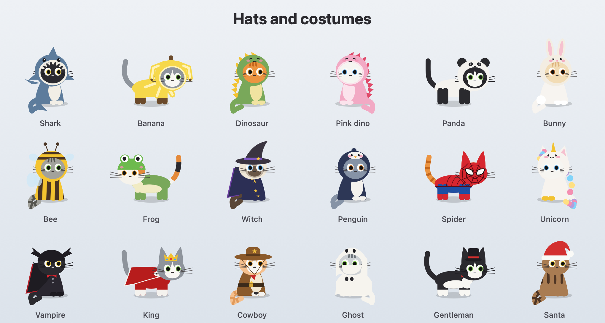

# Kotiki

Desktop cats for macOS. They roam the bottom of your screen, climb onto your windows, nap on widgets, sharpen their claws on the screen edge and chase your cursor. Close the window a cat is dozing on and it tumbles to the floor with an offended face.

Clicks pass straight through the cats, so you keep working as usual. You can feed them, pet them with the cursor and dress them up as a shark or a banana.

Everything lives in the menu bar: the cat icon opens your cat list, bowls, laser pointer and outfits.





## Download

1. Open the [latest release](https://github.com/MiLana-ec/desk-cats/releases/latest) and download `Kotiki-1.3-macOS.zip`.
2. Unzip it and drag `Kotiki.app` into your Applications folder.
3. On first launch macOS warns that it cannot verify the developer, because the app has no Apple certificate. Open System Settings → Privacy & Security, scroll down and click "Open Anyway". On macOS 14 and older, right-click the app and choose Open.

Requires macOS 13 or newer. Runs on Apple Silicon and Intel Macs.

## Languages

The app speaks English, Russian and Chinese (简体中文). It starts in your system language and you can switch it any time with the globe menu at the bottom of the Kotiki menu. The menu, coat and outfit names, cat moods, default cat names and the cats' speech bubbles all follow the chosen language.

## What the cats do

- Walk along the floor, jump onto windows and climb up their sides. Up top they sleep, loaf, wash and sharpen their claws.
- Travel between windows like climbing stairs: walk to the nearest edge, hop to the next window, and keep going until they reach the one they wanted.
- Get down in different ways: some jump, some slide down the side of the window, claws digging in.
- Hang from the bottom edge of a window or widget, paw over paw.
- Climb the side edges of the screen and scratch them like a scratching post.
- Fall when you close the window under them, then hiss and sulk.
- Stalk a sleeping cat, or one with its back turned, wiggle their rumps and pounce. A tumble follows.
- Sniff each other, box, wrestle in a ball of fur, play tag and sleep cheek to cheek.
- Purr when you hold the cursor over them.

## Care and play

- Put food and water bowls anywhere on the screen. A hungry cat finds its bowl on its own.
- Every cat has food, water, energy and mood bars.
- The laser pointer turns your cursor into a red dot. Cats leap after it, and the three most agile ones hang on the cursor and swing as you move the mouse.
- Hold ⌥ Option and drag to pick up a cat or a bowl. A thrown cat flies in an arc.

## Looks

- 18 coats: gray and white, ginger, black, calico, Siamese and more.
- 6 eye colors, including odd eyes.
- 30 hats and 29 costumes: shark, banana, dinosaurs, panda, bunny, bee, witch, Santa and more. Nearly every hat has a matching costume.

Superhero-style items are "inspired by" designs: no logos, letters or character names.

## Build from source

You need macOS 13 or newer and the Xcode command line tools. If you do not have them, install with:

```bash
xcode-select --install
```

Build and run:

```bash
./build.sh
open "build/Kotiki.app"
```

`build.sh` produces a universal app for Apple Silicon and Intel. It is signed locally, without an Apple certificate. If macOS refuses to open it, right-click the app and choose Open.

## Permissions

- The app sees windows, widgets and the cursor without extra permissions.
- To let cats walk on your desktop icons, the app asks Finder where they are. macOS shows a one-time prompt: "Kotiki wants to control Finder". If you decline, the icons just stop being platforms.

## How to turn it off

The switch in the menu hides every cat. The Quit button closes the app and the cats disappear. Your cat list and outfits are saved until the next launch.

## How it is built

The app is written in Swift (AppKit and SwiftUI) with no third-party libraries. The cats are drawn in code, and the project has no image assets.

| File | What is inside |
|---|---|
| `Sources/CatRenderer.swift` | Cat drawing, poses, eyes, masks |
| `Sources/Costumes.swift` | Hood hats and costumes |
| `Sources/World.swift` | Windows as platforms, physics, cat behavior |
| `Sources/Hunt.swift` | Stalking, screen edges, sliding down, widgets and icons |
| `Sources/Play.swift` | Cat play, hanging from the cursor |
| `Sources/Overlay.swift` | Transparent window over the screen |
| `Sources/MenuUI.swift` | Menu bar interface |
| `Sources/Model.swift` | Coats, cat settings, saving |

## License

MIT, see the `LICENSE` file.
